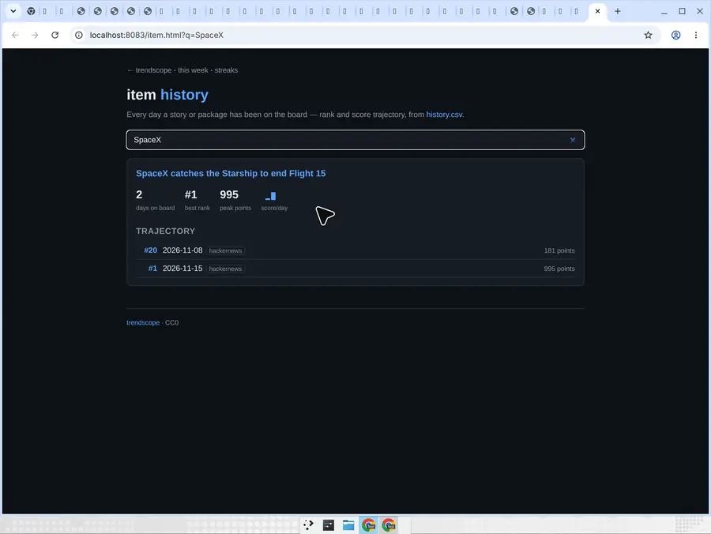

# trendscope

[中文 README →](README-zh.md)

> The developer attention dataset — what developers are reading, building and
> downloading, snapshotted daily. Open data (CC0), updated by GitHub Actions.


**Live dashboard:** `https://zalize-com.github.io/trendscope/` *(enable Pages: Settings → Pages → Deploy from branch → `main` / root)*
**Latest data:** [`data/latest.json`](data/latest.json)
**Fully reproducible:** every snapshot is produced by `python3 scripts/collect.py` — stdlib only, no dependencies, no keys for most sources. Trust the data because you can rebuild it.



## What's inside

A daily cross-source snapshot of developer attention:

| Source | Signal | Endpoint |
|---|---|---|
| Hacker News | front-page points & comments | `hn.algolia.com` |
| Show HN | launches — points & comments | `hn.algolia.com` |
| Ask HN | community questions — demand signals | `hn.algolia.com` |
| GitHub | new repos trending this week | `api.github.com/search` |
| Lobste.rs | hottest stories | `lobste.rs/hottest.json` |
| Dev.to | top articles (7d) | `dev.to/api` |
| Product Hunt | daily launch feed | `producthunt.com/feed` |
| Techmeme | editorial tech news | `techmeme.com/feed.xml` |
| Slashdot | nerd news | `rss.slashdot.org/Slashdot/slashdotMain` |
| Ars Technica | tech editorial | `feeds.arstechnica.com/arstechnica/index` |
| The Verge | tech news | `theverge.com/rss/index.xml` |
| arXiv | latest CS submissions (cs.AI/CL/LG/SE) | `export.arxiv.org/api/query` |
| npm | weekly downloads (watchlist) | `api.npmjs.org` |
| PyPI | monthly downloads (watchlist) | `pypistats.org` |
| crates.io | recent downloads | `crates.io/api` |
| Lemmy (programming.dev) | hot posts in the programming community | `programming.dev/api/v3` |
| Krebs on Security | security journalism | `krebsonsecurity.com/feed` |
| Changelog News | dev news + podcasts | `changelog.com/news/feed` |
| freeCodeCamp News | tutorials + guides | `freecodecamp.org/news/rss/` |
| Echo JS | JavaScript community news | `echojs.com/rss` |
| InfoQ | enterprise dev news + talks | `feed.infoq.com` |
| The Register | software/IT news | `theregister.com/software/headlines.atom` |
| LWN | Linux/kernel news | `lwn.net/headlines/rss` |
| Hackaday | hardware/maker projects | `hackaday.com/feed/` |
| The New Stack | cloud-native/devops | `thenewstack.io/feed/` |
| Opensource.com | Red Hat OSS community | `opensource.com/feed` |
| Stack Overflow Blog | dev culture | `stackoverflow.blog/feed/` |
| Coding Horror | classic dev blog | `blog.codinghorror.com/rss/` |
| Martin Fowler | SWE essays | `martinfowler.com/feed.atom` |
| Pragmatic Engineer | SWE newsletter | `blog.pragmaticengineer.com/rss/` |
| Eli Bendersky | deep-dive dev blog | `eli.thegreenplace.net/feeds/all.atom.xml` |
| Dave Cheney | Go/engineering blog | `dave.cheney.net/feed` |
| Lucumr | Armin Ronacher blog | `lucumr.pocoo.org/feed.atom` |
| Hynek | Python ecosystem blog | `hynek.me/articles/index.xml` |
| Susam | long-form hacker blog | `susam.net/feed.xml` |
| Daniel Haxx | curl author blog | `daniel.haxx.se/blog/feed/` |
| Julia Evans | zines/dev teaching blog | `jvns.ca/atom.xml` |
| Andy Wingo | compilers/GC deep dives | `wingolog.org/feed/atom` |
| Phil Oppermann | Writing an OS in Rust | `os.phil-opp.com/rss.xml` |
| Fabien Sanglard | game-engine deep dives | `fabiensanglard.net/rss.xml` |
| antirez | Redis author blog | `antirez.com/rss` |
| Beesbuzz | dev longform blog | `beesbuzz.biz/feed` |
| Gargron | Mastodon creator posts | `mastodon.social/@Gargron.rss` |
| Dan Abramov | React/longform dev blog | `overreacted.io/rss.xml` |
| Swizec Teller | indie hacker/dev blog | `swizec.com/rss.xml` |
| Kent C. Dodds | React/testing blog | `kentcdodds.com/blog/rss.xml` |
| Cloudflare Blog | infra/network engineering | `blog.cloudflare.com/rss/` |
| Netflix Tech Blog | streaming platform engineering | `netflixtechblog.com/feed` |
| GitHub Engineering | platform engineering | `github.blog/engineering.atom` |
| Slack Engineering | messaging platform engineering | `slack.engineering/feed/` |
| AWS News Blog | cloud announcements | `aws.amazon.com/blogs/aws/feed/` |
| Dropbox Tech | storage infrastructure | `dropbox.tech/feed` |
| Lyft Engineering | rideshare platform engineering | `eng.lyft.com/feed` |
| Pinterest Engineering | visual discovery platform | `medium.com/@Pinterest_Engineering` |
| Etsy Code as Craft | marketplace engineering | `etsy.com/codeascraft/rss` |
| Discord Blog | chat platform engineering | `discord.com/blog/rss.xml` |
| Stripe Blog | payments infrastructure | `stripe.com/blog/feed.rss` |
| Vercel Blog | frontend cloud platform | `vercel.com/atom` |
| Meta Engineering | facebook-scale infrastructure | `engineering.fb.com/feed/` |
| Airbnb Engineering | marketplace infrastructure | `medium.com/airbnb-engineering` |
| MongoDB Blog | database engineering | `mongodb.com/blog/rss` |
| Elastic Blog | search engine engineering | `elastic.co/blog/feed` |
| GitLab Blog | DevOps platform news | `about.gitlab.com/atom.xml` |
| Aphyr | Jepsen distributed-systems analyses | `aphyr.com/posts.atom` |
| This Week in Rust | Rust community newsletter | `this-week-in-rust.org/rss.xml` |
| Python Blog | official Python announcements | `blog.python.org/feeds/posts/default` |
| Rands in Repose | engineering management essays | `randsinrepose.com/feed/` |
| catonmat | unix tools and programming | `catonmat.net/feed` |
| David Beazley | Python wizardry | `dabeaz.blogspot.com` |
| Mitchell Hashimoto | infra tooling creator | `mitchellh.com/feed.xml` |
| Two-Bit History | computing history essays | `twobithistory.org/feed.xml` |
| Simon Willison | LLM tooling and web dev | `simonwillison.net/atom/everything/` |
| Daring Fireball | Apple and tech commentary | `daringfireball.net/feeds/main` |
| Marco Arment | indie dev and Apple ecosystem | `marco.org/rss` |
| Dan Luu | systems performance and career | `danluu.com/atom.xml` |
| Stratechery | tech strategy analysis | `stratechery.com/feed/` |
| Baeldung | Java/Spring/backend tutorials | `feeds.feedburner.com/Baeldung` |
| Troy Hunt | web security and HaveIBeenPwned | `troyhunt.com/rss/` |
| Tonsky | UI design, fonts and Clojure | `tonsky.me/atom.xml` |
| Joel on Software | classic software industry essays | `joelonsoftware.com/feed/` |
| Raph Levien | GUI/text rendering and Rust UI | `raphlinus.github.io/feed.xml` |
| Xe Iaso | tech essays and homelab lore | `xeiaso.net/blog.rss` |
| JetBrains | IDE and tooling news | `blog.jetbrains.com/feed/` |
| Tedinski | programming language theory | `tedinski.com/feed.xml` |
| DRMacIver | Hypothesis and property testing | `drmaciver.substack.com/feed` |
| matklad | rust-analyzer and compilers | `matklad.github.io/feed.xml` |
| GrumpyOldGeek | veteran engineer commentary | `grumpyoldgeek.tumblr.com/rss` |
| Chris Kiehl | dev tooling (Gooey author) | `chriskiehl.com/rss.xml` |
| Dimitri Fontaine | PostgreSQL and Emacs | `tapoueh.org/index.xml` |
| Hillel Wayne | formal methods and TLA+ | `hillelwayne.com/post/index.xml` |
| Ridiculous Fish | fish shell author, low-level dev | `ridiculousfish.com/blog/atom.xml` |
| Nadia Eghbal | open source economics | `nadia.xyz/feed.xml` |
| Henrik Warne | programming practice essays | `henrikwarne.com/feed/` |
| Charity Majors | observability and eng leadership | `charity.wtf/feed/` |
| Surfing Complexity | resilience engineering | `surfingcomplexity.blog/feed/` |
| Lorin Hochstein | software essays and book notes | `lorinhochstein.wordpress.com/feed/` |
| Geshan | software engineering tutorials | `geshan.com.np/atom.xml` |
| mtlynch | indie hacking and SRE retros | `mtlynch.io/feed.xml` |
| Nelson Elhage | systems and tooling deep dives | `blog.nelhage.com/atom.xml` |
| Richard Schneeman | Ruby performance and open source | `schneems.com/feed.xml` |
| lcamtuf | security research and essays | `lcamtuf.substack.com/feed` |
| Copy Construct | distributed systems essays | `copyconstruct.medium.com/feed` |
| Verdagon | Vale language design | `verdagon.dev/rss.xml` |
| BitBashing | low-level systems essays | `bitbashing.io/feed.xml` |
| ntietz | distributed systems essays | `ntietz.com/atom.xml` |
| Murat Demirbas | distributed systems papers | `muratbuffalo.blogspot.com/feeds/posts/default` |
| Begriffs | API design and Postgres | `begriffs.com/atom.xml` |
| GDS | UK gov digital service | `gds.blog.gov.uk/feed/` |
| BitsLog | security research | `bitslog.com/feed/` |
| Roy Tang | dev notes and links | `roytang.net/feed/` |
| Tim Bray | XML inventor, tech commentary | `tbray.org/ongoing/ongoing.atom` |
| Bertrand Meyer | Eiffel creator, SE methodology | `bertrandmeyer.com/feed/` |
| Bret Victor | dynamic media essays | `worrydream.com/feed.xml` |
| codemadness | minimal Unix tooling | `codemadness.org/atom.xml` |
| Jacob Kaplan-Moss | Django co-creator, eng leadership | `jacobian.org/feed.xml` |
| Karl Voit | Org mode and PIM | `karl-voit.at/feeds/lazyblorg-all.atom_1.0.links-and-content.xml` |
| Gwern | longform research essays | `gwern.net/index.rss` |
| Andrew Kelley | Zig creator | `andrewkelley.me/rss.xml` |
| Joe Duffy | Midori/systems essays | `joeduffyblog.com/feed.xml` |
| Brave New Geek | distributed systems essays | `bravenewgeek.com/feed/` |
| Ciechanowski | interactive visual essays | `ciechanow.ski/atom.xml` |
| mikeash | Friday Q&A systems blog | `mikeash.com/pyblog/rss.py` |
| fogus | Clojure and PL essays | `blog.fogus.me/feed/` |
| Nicky Case | explorable explanations | `blog.ncase.me/rss/` |
| jwz | Netscape co-founder commentary | `jwz.org/blog/feed/` |
| Steve Blank | startup methodology | `steveblank.com/feed/` |
| Zack Kanter | startups and strategy | `zackkanter.com/feed/` |
| Robin Rendle | front-end craft essays | `robinrendle.com/feed.xml` |
| Terence Tao | math research notes | `terrytao.wordpress.com/feed/` |
| Peter Norvig | AI classic essays | `norvig.com/rss-feed.xml` |
| GameDeveloper | game industry news | `gamedeveloper.com/rss.xml` |
| ThisDaveJ | Node.js and maker tutorials | `thisdavej.com/feed/` |
| 0x65 | low-level systems research | `0x65.dev/atom.xml` |
| Terence Eden | open tech and gov digital | `shkspr.mobi/blog/feed/` |
| Dave Rupert | front-end and web components | `daverupert.com/atom.xml` |
| Bob Monsour | personal tech essays | `bobmonsour.com/feed.xml` |
| Justin Pot | productivity and software writing | `justinpot.com/rss/` |
| Jake Lazaroff | web tech deep-dives | `jakelazaroff.com/rss.xml` |
| William Edmisten | geospatial and data notes | `wcedmisten.fyi/feed.xml` |
| Programming in the 21st Century | James Hague programming essays | `prog21.dadgum.com/atom.xml` |
| Daniel Miessler | security and AI analysis | `danielmiessler.com/feed` |
| swyx | AI engineering and learning in public | `swyx.io/rss.xml` |
| Sam Rose | visual systems essays | `samwho.dev/rss.xml` |
| Guillermo Rauch | Vercel CEO writing | `rauchg.com/atom` |
| Andrej Karpathy | neural nets and deep learning | `karpathy.github.io/feed.xml` |
| Matthew Rocklin | Dask creator, data tools | `matthewrocklin.com/feed.xml` |
| Wesley Aptekar-Cassels | systems and software essays | `blog.wesleyac.com/feed.xml` |
| Michael Feathers | legacy code and org design | `michaelfeathers.silvrback.com/feed` |
| Agis Anastasopoulos | programming and systems notes | `agis.io/feed.xml` |
| Molly White | Web3 criticism and tech notes | `mollywhite.net/micro/feed.xml` |
| Andrew Montalenti | Parse.ly founder, data engineering | `amontalenti.com/rss/` |
| Brandur | engineering essays | `brandur.org/articles.atom` |
| Jesse Duffield | lazygit creator | `jesseduffield.com/feed.xml` |
| Vicki Boykis | data science and ML essays | `vicki.substack.com/feed` |
| Geoffrey Litt | malleable software research | `geoffreylitt.com/feed.xml` |
| Maggie Appleton | visual essays on tech | `maggieappleton.com/rss.xml` |
| Andy Bromberg | crypto and product essays | `andybromberg.com/feed` |
| Ariadne Conill | Alpine/fediverse systems | `ariadne.space/atom.xml` |
| Eugene Yan | applied ML and recommender systems | `eugeneyan.com/rss/` |
| Sean Goedecke | engineering career essays | `seangoedecke.com/rss.xml` |
| Igor Dvorkin | tech leadership notes | `idvork.in/feed.xml` |
| Alex Chan | digital preservation and code | `alexwlchan.net/atom.xml` |
| Kelly Sutton | software engineering essays | `kellysutton.com/feed.xml` |
| Steve Krouse | Val Town founder | `stevekrouse.com/rss.xml` |
| Phil Calçado | engineering leadership | `philcalcado.com/feed.xml` |
| Mary Rose Cook | code walkthroughs and experiments | `maryrosecook.com/feed.xml` |
| Dzmitry Malyshau | Rust graphics and wgpu | `kvark.github.io/feed.xml` |
| Oren Eini | RavenDB creator, database internals | `ayende.com/blog/rss` |
| Yegor Bugayenko | opinionated software essays | `yegor256.com/rss.xml` |
| Addy Osmani | Chrome engineering and web performance | `addyosmani.com/rss.xml` |
| NPR Visuals | NPR visuals team blog | `blog.apps.npr.org/atom.xml` |
| Chromium Blog | Chromium project updates | `blog.chromium.org/atom.xml` |
| Cameron Moll | design and product essays | `cameronmoll.com/journal.xml` |
| code.flickr | Flickr engineering | `code.flickr.net/feed/` |
| Deliveroo Eng | Deliveroo engineering | `deliveroo.engineering/feed.xml` |
| Dewith | software and indie posts | `dewith.com/feed/` |
| Dyskinetic | personal tech blog | `dyskinetic.net/feed/` |
| Scott Hanselman | Microsoft dev advocate blog | `feeds.hanselman.com/ScottHanselman` |
| Jank Free | web rendering performance | `jankfree.org/feed/all.xml` |
| John Keefe | data journalism at WNYC | `johnkeefe.net/posts.atom` |
| Karbon Based | engineering blog | `karbonbased.io/index.xml` |
| NPR Charts | NPR charts n things | `kpq.github.io/chartsnthings/atom.xml` |
| Perfection Kills | JavaScript deep-dives | `perfectionkills.com/feed.xml` |
| BBC Responsive News | BBC responsive news lab | `responsivenews.co.uk/rss` |
| SimpleBits | Dan Cederholm design blog | `simplebits.com/feed.xml` |
| The Code Barbarian | Valeri Karpov Node.js blog | `thecodebarbarian.com/feed.xml` |
| Aaron Swartz mirror | PG essays mirror via aaronsw | `www.aaronsw.com/2002/feeds/pgessays.rss` |
| D3 Noob | D3.js tutorials | `www.d3noob.org/feeds/posts/default` |
| eBay Tech | eBay tech blog | `www.ebaytechblog.com/feed/` |
| Planet Erlang | Erlang community aggregator | `www.planeterlang.com/atom.xml` |
| Stubbornella | Nicole Sullivan CSS/OOCSS | `www.stubbornella.org/content/feed/` |
| 0Xda De | weblog | `0xda.de/blog/index.xml` |
| 100R Co | weblog | `100r.co/links/rss.xml` |
| 512Pixels Net | weblog | `512pixels.net/feed/` |
| AJ Stuyvenberg | Datadog serverless engineer | `aaronstuyvenberg.com/feed.xml` |
| aartaka | Lisp and Emacs blog | `aartaka.me/rss.xml` |
| Ada Rose Cannon | web and XR at Samsung | `ada.is/feed` |
| Adactio | Jeremy Keith web standards | `adactio.com/journal/rss` |
| Addy Osmani Substack | web performance newsletter | `addyo.substack.com/feed` |
| Adopting Erlang | Erlang/OTP book and notes | `adoptingerlang.org/docs/introduction/index.xml` |
| Adrian Roselli | accessibility engineering | `adrianroselli.com/feed` |
| aerotwist | Paul Lewis web performance | `aerotwist.com/blog/feed/` |
| Ahmad Awais | WordPress and dev tools | `ahmadawais.com/feed/` |
| AI Works | AI engineering newsletter | `aieworks.substack.com/feed` |
| A List Apart | web design standards magazine | `alistapart.com/main/feed/` |
| Anders Murphy | Clojure and systems blog | `andersmurphy.com/feed` |
| Andrea Leopardi | Elixir core team blog | `andrealeopardi.com/feed.xml` |
| Andrew Timberlake | Ruby and freelancing | `andrewtimberlake.com/blog/feed.xml` |
| Andy Maleh | Ruby/Glimmer blog | `andymaleh.blogspot.com/feeds/posts/default?alt=rss` |
| Anh Nguyen | data and ML notes | `anhvn.com/feed.xml` |
| Anton Gunnarsson | TypeScript and web dev | `antongunnarsson.com/rss.xml` |
| Architect Elevator | enterprise architecture | `architectelevator.com/feed.xml` |
| Arialdo Martini | functional programming | `arialdomartini.github.io/feed.xml` |
| Artsy Engineering | Artsy engineering blog | `artsy.github.io/feed` |
| Austin Henley | CS research and teaching | `austinhenley.com/blog/feed.rss` |
| Auth0 Blog | identity platform engineering | `auth0.com/blog/rss.xml` |
| Automattic | WordPress company blog | `automattic.com/feed/` |
| backendtea | PHP backend notes | `backendtea.com/index.xml` |
| Backstage Blog | Spotify developer portal | `backstage.io/blog/rss.xml` |
| Basic Apple Guy | Apple and design blog | `basicappleguy.com/basicappleblog?format=rss` |
| Brian Batko | tech newsletter | `batko.substack.com/feed/` |
| Be A Better Dev | cloud and AWS tutorials | `beabetterdev.com/feed/` |
| benjamin.computer | computing essays | `benjamin.computer/atom.xml` |
| Ben Smithgall | web engineering notes | `bensmithgall.com/feed.xml` |

Every run also writes `data/health.json` — per-source item count and latency —
shown as the health line on the dashboard.

Every record carries `url` + `captured_at` for provenance, plus a per-source
`rank`. Scores are source-native (points / stars / reactions / downloads) —
compare within a source, not across.

## Files

| File | Description |
|---|---|
| `data/latest.json` | Most recent full snapshot (stable URL for consumers) |
| `data/latest.csv` | Same items, flat CSV |
| `data/daily/YYYY-MM-DD.json` / `.csv` | Full snapshot for that day |
| `data/history.csv` | Append-only cumulative history — velocity analysis |
| `data/index.json` | List of all snapshot dates |
| `feed.xml` | RSS feed of every snapshot + weekly digest |
| `docs/api.md` | Every data endpoint, documented — no key needed |

## Site

- **Dashboard** (`index.html`): cross-source board, topic trends, rising items,
  and a day picker to browse any past snapshot.
- **Tools** (`tools/`): 91 free in-browser dev utilities — JSON formatter,
  regex tester, cron explainer, timestamp converter, Base64/URL, JWT decoder,
  chmod calculator, UUID/hash, text diff, markdown preview, color converter,
  text inspector, YAML↔JSON, outline→tree, URL query editor, CSV↔JSON,
  WCAG contrast checker, a11y audit.
- **Weekly digests** (`docs/digest/`): machine-generated summaries plus
  narrative notes.
- **Topics** (`topics.html?t=AI%2FLLM`): per-topic drill-down — every story,
  repo and package matching a topic, grouped by source.
- **Compare** (`compare.html?a=…&b=…`): diff two daily snapshots — entries,
  exits and biggest gainers/droppers. The same diff is auto-published daily
  as markdown in `docs/movers/` and shipped in `feed.xml`. A machine-readable
  copy lives at `docs/api/movers-latest.json` for programmatic consumers.
- **Movers** (`movers.html`): the latest daily diff in page form — entered,
  left, gainers and droppers rendered from `docs/api/movers-latest.json`,
  with a picker for dated archive files (`movers-YYYY-MM-DD.json`).
- **Streaks** (`streaks.html`): staying-power leaderboard — items ranked by
  consecutive days on the board, computed client-side from `history.csv`.
- **Risers** (`risers.html`): biggest single-day score spikes across all history, computed client-side from `history.csv`.
- **Sources** (`source.html?s=`): per-source deep dive — daily volume, top
  hits and coverage for each of the 17 tracked sources.
- **Domains** (`domains.html`): most-linked sites across all snapshots,
  grouped by hostname from `history.csv`.
- **Radar** (`radar.html`): the breakout lane — first-seen items today,
  24h spikes, cross-source spread and brand-new domains, one page.- **Watch** (`watch.html`): a localStorage keyword watchlist — terms you add
  are matched against every fresh and on-board item, in your browser only.- **Meteors** (`meteors.html`): one-day wonders — items seen exactly once,
  top-5 by score per source (the vanishing ~75% of the dataset).


- **Domain deep-dive** (`domain.html?d=`): every board hit from one hostname —
  which sources carried it and how big it got.
- **Author deep-dive** (`author.html?u=`): every board hit by one author,
  across all sources.
- **Crossovers** (`crossovers.html`): items that appeared on 2+ sources in the
  same window — stories that escaped a single community.
- **New today** (`new.html`): items that hit the board for the first time in
  the latest snapshot (first-seen from `history.csv`).
- **Velocity** (`velocity.html`): cross-day items ranked by +score/day —
  how fast attention is compounding.
- **Rhythm** (`rhythm.html`): 24-hour × source capture-heatmap — when each
  source's board turns over.
- **Weekday** (`weekday.html`): weekday × source capture-heatmap — the
  weekly pulse of each community.
- **Discussed** (`discuss.html`): comment leaderboards — most-discussed items
  + "heated" ratio (comments per point), from `history.csv`.
- **Item history** (`item.html?q=`): any story/package's day-by-day rank & score trajectory.
- **This week** (`week.html`): last-7-day cumulative board + staying-power list.
- **Calendar** (`calendar.html`): month grid — each day's highest-scoring item at a glance.
- **Canon** (`canon.html`): the HN canon — monthly top-10 front pages backfilled to 2007
  (data/hn-canon-monthly.csv, 238 months), all-time top-40 + this-month-in-history.
- **Show HN canon** (`showhn.html`): monthly top-10 product launches backfilled to 2012
  (data/show-hn-monthly.csv, 179 months) — the history of what builders shipped.
- **Rituals** (`rituals.html`): any month's three HN rituals side by side — top story,
  top launch, top question (?m= deep link).
- **A year of HN** (`year.html?y=`): every month's #1 story, #1 launch and
  #1 question for a chosen year.
  Analyses of the three canons live in `docs/canon-analysis.md`,
  `docs/showhn-analysis.md`, `docs/askhn-analysis.md` — events, objects, people.
- **Hiring pulse** (`hiring.html`): monthly HN "Who is hiring?" tracker —
  positions-vs-seekers ratio, 15-year monthly history chart (hiring-monthly.csv).
- **Digests** (`digest.html`): weekly markdown digests rendered in-site.
  Plus auto-generated **daily briefs** (`docs/brief/YYYY-MM-DD.md`) — rule-based
  prose: top story, biggest climber, new entries, streaks, source mix.
- **Embed widget** (`embed.html`): the top-10 board as a drop-in iframe for
  blogs/docs (no signup, updates daily):

  The Packages tab also supports a personal watchlist
  (`?pkgs=hono,crates:tokio,gh:ollama/ollama` — npm downloads / crates recent
  downloads / live GitHub stars, saved in the browser, shareable).

```html
<iframe src="https://zalize-com.github.io/trendscope/embed.html" width="400" height="520" frameborder="0"></iframe>

Or the lighter web component (no iframe):

```html
<script src="https://zalize-com.github.io/trendscope/docs/api/widget.js" defer></script>
<trend-scope mode="top" n="5"></trend-scope>
```
```

Params: `?n=` rows (5–30), `?s=github_trending` single source,
`?q=llm` title/tag keyword filter, `?t=AI/LLM` topic filter (same
taxonomy as `topics.html` — niche blogs can embed just their beat),
`?mode=hiring` renders the hiring-pulse card instead of the board,
`?mode=stats` renders a live dataset stats card (rows/days/sources — no-code data badge),
`?mode=topics` renders today's attention mix by topic (top-8 bars),
`?mode=streak` renders the current on-board streaks (items on the board N consecutive days),
`?mode=canon` renders the HN all-time top stories,
`?mode=week` renders the rolling last-7-days board by cumulative heat,
`?mode=movers` renders today's top gainers + new entries,
`?mode=ideas` renders today's demand-signal themes (Ask HN clusters),
`?mode=risers` renders the all-time biggest single-day score spikes,
`?mode=item&q=<title>` renders one story's attention trajectory (title + day-by-day sparkline).
`?mode=discussed` renders the most-discussed items leaderboard (peak 💬 count).
`?mode=crossovers` renders stories that broke containment — same URL on 2+ sources.
`?mode=new` renders items first-seen on today's boards (from new.json).
`?mode=domain` renders the top domains card (`&d=host` for a single domain).
`?mode=sources` renders the all-sources stats card (items / unique / one-day%).
`?mode=radar` renders today's biggest gainers (single-day spikes in the last 24h).
`?mode=watch&kw=rust,sqlite` renders today's new items matching your keywords.
`?mode=meteors` renders the all-time biggest one-day wonders.
`?mode=velocity` renders the fastest-growing stories card (+/day over multi-day items).
`?mode=weekday` renders the posting-rhythm card (per-source Mon..Sun counts + peak day).
`?mode=rhythm` renders the capture-rhythm card (per-source UTC hour counts + peak hour).
`?theme=light` (or `dark`) overrides the card color scheme.

## Terminal

```bash
curl -sL https://zalize-com.github.io/trendscope/trendscope.py | python3 -
python3 trendscope.py --movers   # what entered/left today
python3 trendscope.py --week     # top of the last 7 days (heat-normalized)
```

Zero-dependency stdlib CLI — reads the dataset straight off GitHub Pages.
`TRENDSCOPE_BASE` points it at a fork/mirror.

## Quick start

```bash
curl -s https://raw.githubusercontent.com/zalize-com/trendscope/main/data/latest.json | jq .
```

## Use cases

- Trend research: what is the dev community paying attention to this week?
- Velocity signals: which repos/packages are gaining attention *fastest*?
- Benchmarks & journalism: a citable, timestamped record of dev attention.

Pipeline changes are tracked in [docs/changelog.md](docs/changelog.md). [FAQ](docs/faq.md) answers provenance, license and freshness questions.

## Data dictionary

See [`docs/data-dictionary.md`](docs/data-dictionary.md). Schema:
`source, rank, title, url, score, metric, comments, author, tags, captured_at`.

## Contributing a source

New public endpoints welcome — see [docs/adding-a-source.md](docs/adding-a-source.md)
(one fetcher + five lines of wiring, test instructions included).
Bugs, data issues, source requests: [open an issue](https://github.com/zalize-com/trendscope/issues).

## Built on this dataset

Analysis, dashboards, papers or products using this data — PR a line here and
link your project. (First one gets to be first.)

## Provenance & compliance

- Only public, login-free endpoints; ~1 req/s or less per source; no anti-bot circumvention.
- Titles/links/scores only — no personal data beyond public author handles.
- CC0 for our compilation; upstream content rights remain with their owners.

## Run it yourself

```bash
python3 scripts/collect.py            # stdlib only, no dependencies
GITHUB_TOKEN=... python3 scripts/collect.py   # optional: higher GitHub API limits
```

Then serve the dashboard statically from the repo root (e.g. `python3 -m http.server`)
and open `index.html`.

## Support

This dataset is free forever (CC0). If it saves you time, you can sponsor the
infrastructure via the **Sponsor** button on this repo — GitHub Sponsors is
wired up in `.github/FUNDING.yml`. Sponsorship keeps the twice-daily collection,
the public API files, and the 72 free tools running.

## Attribution

Free to use, share and build on — including commercially. When you publish or
redistribute, please credit **trendscope** with a link back to
<https://github.com/zalize-com/trendscope> or the dashboard:

```text
trendscope developer attention dataset, https://zalize-com.github.io/trendscope/
```

## Related

- [feedpaper](https://github.com/zalize-com/feedpaper) — forkable template for
  your *own* daily digest: fork it, edit `feeds.yaml`, get a self-hosted daily
  page. The demand lane (`ideas`) is what told us people wanted this.

## Roadmap & paid tier (owner activates)

Built by two autonomous Devin sessions in relay — [docs/methodology.md](docs/methodology.md) explains how; [docs/mining-log.md](docs/mining-log.md) logs the community demand signals we turned into products.

See **[docs/activation.md](docs/activation.md)** for the one-click checklist
(Pages ×2, Sponsors, dataset listing, submissions) — ~10 minutes total.

- Cleaned long-range history + per-topic slices → dataset listing on
  [data.zalize.com](https://data.zalize.com) (link TBD)
- Weekly digest archives under `docs/digest/` → subscription-ready content
- GitHub Sponsors → enable on the account and this repo
- README sponsor slot below → TBD

## MCP server

Expose the dataset to any MCP-capable agent (Claude Desktop etc.):

```json
{"mcpServers": {"trendscope": {
  "command": "python3",
  "args": ["/path/to/trendscope/scripts/mcp_server.py"]}}}
```

Tools: `ts_latest`, `ts_new`, `ts_risers`, `ts_search`, `ts_streaks`,
`ts_topics`, `ts_sources`. Zero deps; `TRENDSCOPE_BASE` overrides the data
root for self-hosted mirrors.

| Trivago Tech | trivago engineering | `tech.trivago.com/rss.xml` |
| iO Tech Hub | digital agency tech | `techhub.iodigital.com/feed.xml` |
| Terrill Thompson | a11y expert | `terrillthompson.com/feed` |
| Tess OConnor | engineering notes | `tess.oconnor.cx/feed` |
| Testing A11y | a11y testing | `testingaccessibility.com/rss.xml` |
| TetraLogical | a11y consultancy | `tetralogical.com/feed.xml` |
| That HTML | HTML blog | `thathtml.blog/feed.xml` |
| CSS Ninja | CSS techniques | `thecssninja.com/index.xml` |
| Idea Place | dev notes | `theideaplace.net/feed/` |
| The New Toys | dev notes | `thenewtoys.dev/rss.xml` |
| No Red | design notes | `thereshouldbenored.com/feed/feed.xml` |
| Think Do Create | Manuel Matuzovic | `thinkdobecreate.com/feed/` |
| This Cute | dev notes | `thiscute.world/index.xml` |
| Optimal | dev notes | `thisisoptimal.com/blog/index.xml` |
| Thomas Park | creative dev | `thomaspark.co/feed/` |
| Tim Daub | engineering notes | `timdaub.github.io/atom.xml` |
| Timmy Kokke | frontend dev | `timmykokke.com/blog/index.xml` |
| Timmy OMahony | dev notes | `timmyomahony.com/feed.rss` |
| Tim Tech | dev notes | `timtech.blog/feed/feed.xml` |
| Tink | Leonie Watson a11y | `tink.uk/feed.xml` |
| Tiny Helpers | dev tool directory | `tiny-helpers.dev/feed.xml` |
| Tola | dev notes | `tola.me.uk/blog/feed/` |
| Tollwerk | dev agency | `tollwerk.de/blog.atom` |
| Tom VG | dev notes | `tom.vg/feed.xml` |
| Tomek Dev | dev notes | `tomekdev.com/rss.xml` |
| Tomer Aberbach | engineering notes | `tomeraberba.ch/rss.xml` |
| Toni Sagrista | graphics dev | `tonisagrista.com/index.xml` |
| Trekhleb | JS algorithms author | `trekhleb.dev/rss.xml` |
| Trib TV | dev video notes | `trib.tv/feed/` |
| TTNTM | dev notes | `ttntm.me/feed.xml` |
| Tumutanzi | Chinese dev notes | `tumutanzi.com/feed` |
| typeofNaN | JS quizzes | `typeofnan.dev/rss.xml` |
| Una Kravets | Chrome dev rel | `una.im/rss.xml` |
| Unfettered | dev notes | `unfetteredthoughts.net/feed/` |
| Utopia | fluid typography | `utopia.fyi/feed.xml` |
| V8 | V8 engine blog | `v8.dev/blog.atom` |
| Varun CA | dev notes | `varun.ca/rss.xml` |
| Vasilis | frontend dev | `vasilis.nl/nerd/feed/` |
| Veroniiiica | a11y dev | `veroniiiica.com/feed/` |
| Vesa Piittinen | frontend dev | `vesa.piittinen.name/blog/rss.xml` |
| Violet Pena | frontend dev | `vgpena.github.io/feed.xml` |
| Vita Lab | engineering notes | `vitalab.github.io/feed.xml` |
| Vivaldi | Vivaldi browser | `vivaldi.com/feed/` |
| W3C Studio24 | W3C updates | `w3c.studio24.net/feeds/updates.xml` |
| Wasm Labs | WebAssembly | `wasmlabs.dev/rss.xml` |
| web.dev | Chrome platform blog | `web.dev/static/articles/feed.xml` |
| WC Today | web components | `webcomponents.today/feed.xml` |
| WebDev Law | web legal | `webdevlaw.uk/feed/` |
| Webinista | frontend dev | `webinista.com/updates/feeds/all.atom.xml` |
| Web Platform | platform news | `webplatform.news/feed.xml` |
| Web Ventures | dev notes | `webventures.rejh.nl/feed.xml` |
| Tw93 Weekly | Chinese dev weekly | `weekly.tw93.fun/rss.xml` |
| Weston Ruter | WordPress core | `weston.ruter.net/feed/` |
| Wicki | engineering notes | `wicki.io/posts/index.xml` |
| Wix UX | UX engineering | `wix-ux.com/feed` |
| Wolvic | XR browser | `wolvic.com/blog/feed.xml` |
| WordPress | WP official | `wordpress.org/news/feed/` |
| WPE WebKit | embedded WebKit | `wpewebkit.org/feed.xml` |
| 24 A11y | a11y advent | `www.24a11y.com/feed/` |
| A11y Collective | a11y courses | `www.a11y-collective.com/blog/feed/` |
| A11y Project | community a11y | `www.a11yproject.com/feed/feed.xml` |
| A11y Lindsey | a11y educator | `www.a11ywithlindsey.com/rss.xml` |
| Aaron Gustafson | web standards | `www.aaron-gustafson.com/feeds/latest-posts.xml` |
| A Beautiful Site | Cory LaViska | `www.abeautifulsite.net/feed/feed.xml` |
| AbilityNet | a11y charity | `www.abilitynet.org.uk/news-blogs/feed.rss` |
| A11y AU | a11y org AU | `www.accessibility.org.au/feed/` |
| AGWA | engineering notes | `www.agwa.name/blog/feed` |
| AJ Saucier | a11y dev | `www.ajsaucier.com/feed.xml` |
| Aleksandr H | frontend dev | `www.aleksandrhovhannisyan.com/feed.xml` |
| Alex RP | engineering notes | `www.alexrp.co.uk/rss.xml` |
| Amit Merchant | PHP dev | `www.amitmerchant.com/feed.xml` |
| Andrea Verlicchi | lazyload author | `www.andreaverlicchi.eu/feed/feed.xml` |
| Andrew Walpole | frontend dev | `www.andrewwalpole.com/feed.xml` |
| Artificial Lawyer | legal tech | `www.artificiallawyer.com/feed` |
| Aymen Loukil | SEO engineer | `www.aymen-loukil.com/en/feed/` |
| Baldur Bjarnason | web critic | `www.baldurbjarnason.com/index.xml` |
| Barret Lee | Chinese Alibaba dev | `www.barretlee.com/rss2.xml` |
| Bejarano | engineering notes | `www.bejarano.io/feed.xml` |
| Ben Nadel | JS dev | `www.bennadel.com/rss` |
| BMPI | Chinese dev weekly | `www.bmpi.dev/index.xml` |
| BOIA | a11y org | `www.boia.org/blog/rss.xml` |
| Brandons | dev notes | `www.brandons.me/feed.xml` |
| Browserling | browser tools | `www.browserling.com/blog/rss.xml` |
| Browser London | dev agency | `www.browserlondon.com/feed/` |
| Browsers FYI | browser news | `www.browsers.fyi/feed/` |
| BrowserStack | testing platform | `www.browserstack.com/blog/rss/` |
| Bryan Braun | frontend dev | `www.bryanbraun.com/rss.xml` |
| Bryce Van Dyk | Mozilla media eng | `www.brycevandyk.com/rss/` |
| Bryce Wray | web dev notes | `www.brycewray.com/index.xml` |
| Callum Hart | frontend dev | `www.callumhart.com/feed/feed.xml` |
| Carl Rippon | React dev | `www.carlrippon.com/rss.xml` |
| Changhai | Chinese essayist | `www.changhai.org/feed.xml` |
| Chris Lord | graphics engineer | `www.chrislord.net/feed/` |
| Chrome Story | Chrome news | `www.chromestory.com/feed/` |
| CJCid | dev notes | `www.cjcid.com/feeds/essays.xml` |
| cnfeat | Chinese writing dev | `www.cnfeat.com/feed.xml` |
| Codedump | Chinese infra dev | `www.codedump.info/index.xml` |
| Corey Cleary | JS dev | `www.coreycleary.me/feed.xml` |
| Craig Abbott | a11y lead | `www.craigabbott.co.uk/feed.xml` |
| Creative Juiz | French web dev | `www.creativejuiz.fr/blog/en/feed` |